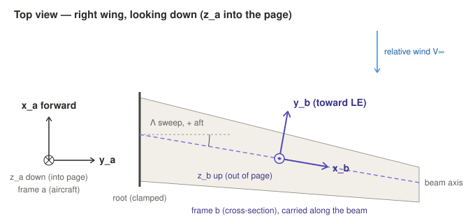

# gebtaero-jax

**Differentiable nonlinear aeroelasticity of high-aspect-ratio wings, in pure Python/JAX.**

`gebtaero-jax` is a modern re-implementation of two research codes:

* [**GEBTAero**](https://github.com/mid2SUPAERO/GEBTAero) (ISAE-Supaero / French Air Force Academy): a
  geometrically exact beam (GEBT, W. Yu) coupled with strip aerodynamics, built for fast flutter/divergence
  computation and aeroelastic tailoring of composite wings. Fortran + MUMPS + ARPACK + CalculiX.
* [**Aeroelasticity.jl**](https://github.com/byuflowlab/Aeroelasticity.jl) (BYU FLOW Lab): a modular framework that
  couples implicit submodels (2D aerodynamics, typical section, GXBeam, rigid body) into monolithic systems.

and extends them with worked examples drawn from further sources: S. He's mode-tracking eigen-adjoint (notebook 08, CRM-like
wing), the EcoHALE and [DawnDesignTool](https://github.com/peterdsharpe/DawnDesignTool) solar-HALE designs (notebook 09)
and the AePW3 Large Deflection Working Group **Pazy wing** benchmark from
[UM-A2SRL/AePW3-LDWG](https://github.com/UM-A2SRL/AePW3-LDWG) (notebook 10).

Both codes are rebuilt around one idea: **write the residual `R(ẋ, x, p, t) = 0`, let JAX do the calculus.**
Tangent stiffness, mass matrices, the implicit derivatives of nonlinear equilibria, eigenvalue sensitivities and
the gradient of the flutter speed with respect to *any* design parameter (ply angles, stiffnesses, CG position,
controller gains…) all come from automatic differentiation. No Fortran, no compiled dependencies, no hand-derived
Jacobians.

```python
import gebtaero_jax as gx

cs = gx.CrossSection.from_isotropic(EI2=9.77e6, GJ=0.99e6).with_mass(mu=35.71, i22=8.64e-4, i33=8.64, nu=0.18288)
goland = gx.straight_wing(cs, span=6.096, chord=1.8288, a=-0.34, n_elements=10, aero=gx.Aero.PETERS)

gx.flutter_speed(goland, gx.FlightCondition(rho=1.225), v_min=100, v_max=160)
# CriticalPoint(flutter: V=136.5067 m/s, f=11.1914 Hz)
```

```python
import jax.numpy as jnp

def build(p, V):  # any pytree of design variables -> (model, flight)
    cs = gx.CrossSection.from_isotropic(9.77e6, 0.0, p["GJ"]).with_mass(35.71, 8.64e-4, 8.64, nu=p["nu"])
    return gx.straight_wing(cs, 6.096, 1.8288, -0.34, 10), gx.FlightCondition(velocity=V, rho=1.225)

r = gx.flutter_speed_and_grad(build, {"GJ": 0.99e6, "nu": 0.18288}, 100, 160)
r.dV_dparams  # {'GJ': 1.0092e-04, 'nu': -95.39}  -- matches finite differences to ~7 digits
```

## Features

**Structure** — geometrically exact beam in GEBT's mixed formulation (displacements, Rodrigues rotations, internal
forces/moments, momenta): large deflections, arbitrary 6×6 flexibility (zero entries = rigid DOFs) and mass
matrices, multi-section wings with sweep/dihedral/twist, gravity with CG offsets, tip and distributed loads
(dead or follower), moving root frame, stiffness-proportional structural damping (GXBeam style).

**Aerodynamics** (strip theory, shared with the 2D section models) — steady, quasi-steady (with and without apparent
mass), Wagner (Jones), Peters finite-state inflow; lift slope, zero-lift angle, `c_m0`, `c_d0`, Prandtl–Glauert.

**Cross sections** — isotropic values, solid rectangle, and **composite plates from Classical Laminate Theory**
(differentiable w.r.t. ply angles; replaces GEBTAero's CalculiX homogenisation for plate wings).

**Analyses** — nonlinear static aeroelasticity (`custom_root` ⇒ implicitly differentiable), modal analysis about
the deformed state, V-g sweeps with mode tracking, flutter/divergence search, exact critical-speed gradients,
nonlinear transient simulation (generalised-α in `lax.scan`, differentiable), trim by Newton on AD derivatives.

**Coupled-model framework** — Aeroelasticity.jl's `CoupledModel` in JAX: plug any `jax.numpy` residuals together
with a coupling function and get `linearize`, `steady_state`, `dense_eigen`, `correlate_eigenmodes`,
critical-value search, gradients and time marching. Typical section with all four aero models included.

**Mode tracking + eigen-adjoint** (`gx.tracking`) — S. He's bordered eigenvalue adjoint generalised to the complex,
non-symmetric pencil of the beam: MAC tracking against reference shapes (Hungarian assignment), adjoint gradients of the
MAC loss, tracked frequencies/damping and the flutter speed with **one bordered solve per tracked function** and
matrix-free AD partials — cost independent of the number of design variables.

**Concentrated masses** — `BeamModel.with_point_mass` (motors, booms, pods, stores), differentiable.

**HALE examples** — `examples/hale_wings.py`: beam models of the EcoHALE and Dawn solar-HALE wings reconstructed from
their published designs (assumptions documented), with an AD trim (`trim_alpha`) at any load factor.

**Pazy wing** — `examples/pazy_wing.py` builds the AePW3 benchmark from the published equivalent-beam data
(4×4 stiffness with couplings, lumped nodal inertia, spanwise lift slope), differentiable in stiffness/mass/lift scale factors.

**Migration** — reader for GEBTAero's Fortran `.dat` input files.

## Validation

| Case | gebtaero-jax | Reference |
|---|---|---|
| Patil wing structural modes (Hz) | 0.357, 2.258, 4.941, 5.046, 6.428 | GEBTAero: 0.357, 2.257, 4.941, 5.048, 6.428 |
| Goland flutter, Peters / QS + added mass / QS (m/s) | 136.51 / 64.33 / 35.16 | GEBTAero: 136.5 / 64.34 / 35.26 (lit. 137) |
| Goland divergence (m/s) | 253.2 | GEBTAero: 253 |
| Goland, swept 15° + β, dihedral 15°, twist 45° + α | 136.51 (all) | GEBTAero: 136.5 |
| Goland, Aeroelasticity.jl set-up | 135.1 m/s, 69.01 rad/s | AJ: 140 m/s on a 5 m/s grid, 69.0 rad/s; Palacios: 141 m/s, 69.8 rad/s |
| Patil flutter / divergence (m/s) | 32.15 / 37.23 | GEBTAero: 32.12 / 37.25; Patil et al.: 32.21 / 37.29 |
| Patil, gravity-deformed flutter (m/s) | 23.13 | GEBTAero: 23.35 (approximate hand-coded aero Jacobian) |
| Pazy wing modes (Hz) | 4.19, 28.49, 42.01, 83.10, 105.89 | UM/NAST beam: 4.19, 28.49, 41.88, 83.06, 105.89 |
| Pazy tip deflection, 7° root AoA, 30 / 40 m/s (% semispan) | 14.0 / 25.3 | UM/NAST 13.6 / 25.0; experiment 14.4 / 25.9 |
| Pazy hump onset at 3 / 5 / 7° (m/s) | 51.0 / 43.7 / 39.1 | UM/NAST 50.6 / 43.1 / 38.5; experiment 49 / 43 / 38 |
| Pazy hump offset at 3 / 5 / 7° (m/s) | 56.6 / 47.8 / 42.2 | UM/NAST 55.3 / 46.7 / 41.2; experiment 55 / 48 / — |
| Typical section V_f: Wagner / Peters | 2.170 / 2.165 | AJ: "around 2.2"; exact Theodorsen (in-repo): 2.184 |
| Typical section divergence (all aero models) | 2.82843 | analytic √8 |
| AD vs finite differences (static, eigen, flutter) | 6–8 digits | — |

Most of the above are in the test suite (`pytest`, ~3–10 min depending on cores); the Pazy rows at 3° and 7°, the offsets
and the deflections at 30 / 40 m/s come from notebook 10 (the tests cover the modes, the 7° deflection sweep and the 5° onset).
The tracking adjoint is checked against the left/right-eigenvector formula (1e-7) and finite differences.

## Install

```bash
pip install -e ".[dev]"     # jax, numpy, scipy, matplotlib (+ pytest, jupyter for dev)
pytest -n auto              # 39 tests
```

64-bit floats are enabled on import (`jax_enable_x64`). CPU is the expected target; systems are small and dense.

## Notebooks

| Notebook | Content | Origin |
|---|---|---|
| `01_patil_wing_modes_and_flutter` | modes and shapes, V-g diagram, flutter/divergence, aero models | GEBTAero `IsotropicWing.py`, `cas_test/Patil.py` |
| `02_goland_wing_benchmarks` | 5 aero models, invariance tests, Aeroelasticity.jl set-up, legacy `.dat`, flutter mode | GEBTAero `cas_test/Goland.py`, AJ `goland-stability` |
| `03_nonlinear_static_and_deformed_flutter` | large static deflections, implicit gradients, trim, flutter vs AoA, gravity | GEBTAero `StaticLoads`, `EquilibriumAoA`; AJ `cantilever-steady` |
| `04_time_domain_simulation` | flutter onset in time, growth-rate check, 1−cos gust on a deformed wing | GEBTAero `FlutterVtk`/`TemporalFlutterSpeed` |
| `05_composite_tailoring_with_gradients` | CLT plate, ply-angle sweep, exact dV_f/dθ, SLSQP tailoring | GEBTAero `PlateComposite.py`, `examples/optimisation` |
| `06_typical_section_aeroelasticity_jl` | 4 aero models, root loci, Theodorsen check, simulation, sensitivities | AJ `section-stability`, `section-simulation` |
| `07_custom_coupled_models` | user-defined submodels: cubic spring + flap actuator, LCO, gradient through a simulation | AJ coupling framework |
| `08_crm_mode_tracking_adjoint` | CRM-like swept wing, mode crossing and MAC tracking, He's eigen-adjoint (complex, matrix-free) vs FD and left/right formula, cost vs n_x, 32-variable wingbox sizing with flutter + tracked-mode constraints | S. He's note, `sensitivity_modetracking.ipynb` |
| `09_hale_aeroelasticity_ecohale_dawn` | two solar HALE designs (EcoHALE CO₂ optimum, DawnDesignTool point design): mass closure, modes, trimmed nonlinear deflection, flutter vs. root incidence, gust in time, battery placement, adjoint wall redistribution at constant mass | `EcoHALE_AeroSandbox_1.ipynb`, [DawnDesignTool](https://github.com/peterdsharpe/DawnDesignTool) |
| `10_pazy_wing_aepw3` | AePW3 Large Deflection Working Group benchmark: Pazy beam model from UM-A2SRL/AePW3-LDWG, static deflection up to 50 % semispan vs UM/NAST and experiment, frequency migration with step-to-step MAC tracking (crossing vs veering), hump-mode onset/offset vs root AoA, AD sensitivities and first-order UQ, soft flutter in time | Ritter et al. J. Aircraft 2026; [AePW3-LDWG](https://github.com/UM-A2SRL/AePW3-LDWG) |

## Package layout

```
src/gebtaero_jax/
  beam.py           GEBT mixed-formulation residual (element + system), FlightCondition
  aerodynamics.py   2D strip models (steady, quasi-steady, Wagner, Peters), Prandtl–Glauert
  cross_section.py  flexibility / mass matrices, CLT composite plate
  materials.py      isotropic & orthotropic materials, plies, laminates (ABD)
  wing.py           Frame, WingSection, Wing -> BeamModel discretisation, Aero enum
  solvers.py        static (custom_root), modal, transient simulation
  stability.py      flutter/divergence search, V-g sweeps, eigenvalue & critical-speed gradients
  coupled.py        generic CoupledModel framework (Aeroelasticity.jl)
  section.py        typical section + aero submodels, exact Theodorsen reference
  tracking.py       MAC mode tracking, bordered eigen-adjoint (He), tracked-mode & flutter gradients
  integrators.py    generalised-alpha (lax.scan)
  legacy.py         GEBTAero .dat reader
  plotting.py       V-g plots, 3D wing shapes
examples/
  crm_wing.py       CRM-like swept wing with a sized wingbox (notebook 08)
  hale_wings.py     EcoHALE and Dawn solar-HALE wings, AD trim (notebook 09)
  pazy_wing.py      Pazy wing from the AePW3-LDWG equivalent-beam data (notebook 10)
  data/             goland.dat (GEBTAero), pazy/ (AePW3-LDWG data and reference results, see its README)
docs/               MAPPING.md (source projects -> code), CONVENTIONS.md (frames and signs), figures/
notebooks/          01-10, executed, with outputs
tests/              pytest suite (39 tests)
```

See [`docs/MAPPING.md`](docs/MAPPING.md) for a line-by-line mapping of every source project onto this package,
including what differs and what is not ported.

## Conventions



Frame *a* (aircraft): `x_a` forward, `y_a` along the right wing, `z_a` down. Cross-section frame *b*: `x_b` beam
axis (outboard), `y_b` towards the leading edge, `z_b = x_b × y_b` (up for an unswept wing). Strains
`(γ11, 2γ12, 2γ13, κ1, κ2, κ3)`: extension, shear, torsion, flap and lag bending. `a` is Theodorsen's
reference-axis position in semi-chords (positive aft); `nu` the CG offset (positive aft). Sweep is positive aft,
dihedral positive up, twist positive nose up; α > 0 gives upward lift. Displacements are in frame *a*, so an upward
deflection is negative `z_a`. Root reactions follow GEBT's sign convention (`gx.lift_force` returns the net upward
load). Eigenvalue tables use GEBTAero's `[Re(s)/2π, Im(s)/2π]`.

See [`docs/CONVENTIONS.md`](docs/CONVENTIONS.md) for the full description, the cross-section drawing and every sign
convention of the inputs and outputs.

## License

GPL-3.0-or-later, like GEBTAero's Python code. See [`NOTICE.md`](NOTICE.md) for the GEBT (W. Yu),
Aeroelasticity.jl (MIT) and AePW3-LDWG Pazy data attributions.
