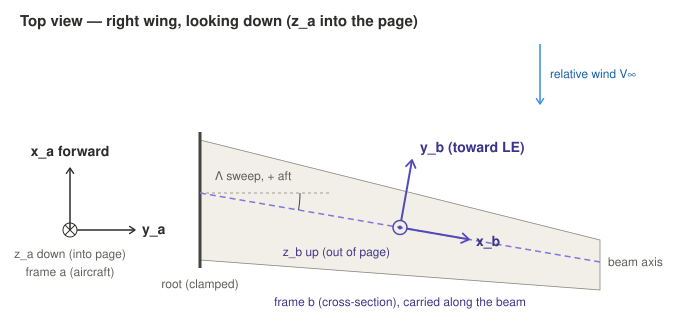
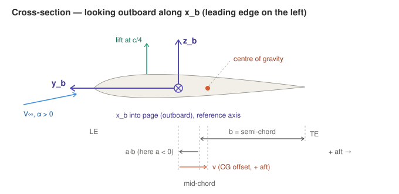

# Frames and sign conventions

gebtaero-jax uses GEBT/GEBTAero's conventions. Two frames matter: the **aircraft frame _a_**, attached at the wing
root, in which loads, gravity, flight conditions and displacements are expressed, and the **cross-section frame
_b_**, carried along the beam, in which the stiffness, mass and strains of each section are defined.





## Frame a — aircraft

| Axis | Direction |
|---|---|
| `x_a` | forward (flight direction) |
| `y_a` | along the right wing |
| `z_a` | down |

Displacements returned by `gx.tip_displacement`, `gx.node_displacements` and `gx.static_outputs` are in frame _a_,
so an upward tip deflection is **negative** `z_a`. The notebooks plot `-z_a` as "height" or "tip deflection up".

## Frame b — cross-section

| Axis | Direction |
|---|---|
| `x_b` | along the beam reference axis, outboard |
| `y_b` | towards the leading edge (forward, for an unswept wing) |
| `z_b` | `x_b × y_b` (up, for an unswept wing) |

The undeformed frame _b_ of each element is stored as the rotation matrix `Cab`, whose **columns** are `x_b`, `y_b`,
`z_b` expressed in frame _a_. For an unswept, untwisted wing (`gx.Frame.from_axis([0, 1, 0])`):

```
x_b =  y_a,   y_b = x_a,   z_b = -z_a        Cab = [[0, 1, 0], [1, 0, 0], [0, 0, -1]]
```

## Wing geometry — `gx.Frame.from_angles(sweep, dihedral, twist)`

| Angle | Positive when | Effect on frame b |
|---|---|---|
| `sweep` Λ | the beam axis goes **aft** | `x_b` gains a `-x_a` component |
| `dihedral` Γ | the beam axis goes **up** | `x_b` gains a `-z_a` component |
| `twist` θ | the leading edge goes **up** (nose up) | rotation about `x_b`; adds local incidence like a positive α |

Angles are in radians. A swept wing flown with an equal side-slip, a wing with dihedral, and a wing with twist θ flown
at α = −θ all reproduce the straight-wing flutter speed (`tests/test_gebtaero_reference.py`).

## Section parameters

| Symbol | In the code | Meaning | Sign |
|---|---|---|---|
| `b` | `chord / 2` | semi-chord | — |
| `a` | `WingSection.a`, `straight_wing(a=...)` | reference (elastic) axis position from mid-chord, in semi-chords (Theodorsen) | **+ aft**: `a = -0.5` is the quarter chord, `a = 0` mid-chord |
| `ν` | `CrossSection.with_mass(nu=...)` | distance from the reference axis to the centre of gravity | **+ aft** of the reference axis |
| `zcg` | `with_mass(zcg=...)` | CG offset along `z_b` | + towards `z_b` |
| `i22`, `i33` | `with_mass(i22=..., i33=...)` | mass moments of inertia per unit length about `y_b` (flap) and `z_b` (lag) | — |

Strip aerodynamics put the lift at the quarter chord. The pitching moment about the reference axis is therefore
nose-up when the reference axis is aft of the quarter chord (`a > -0.5`).

## Strains and stiffness (frame b)

Generalised strains are ordered `(γ11, 2γ12, 2γ13, κ1, κ2, κ3)`; the 6×6 flexibility matrix and the 6×6 mass matrix
follow the same order.

| Strain | Meaning | Stiffness | `from_isotropic` argument |
|---|---|---|---|
| `γ11` | extension along `x_b` | EA | — (rigid by default) |
| `2γ12`, `2γ13` | transverse shear | GA | — (rigid by default) |
| `κ1` | twist rate about `x_b` (torsion) | GJ | `GJ` |
| `κ2` | bending about `y_b` (flap, out-of-plane) | EI₂ | `EI2` (`EI_flap` in the examples) |
| `κ3` | bending about `z_b` (lag, in-plane) | EI₃ | `EI3` (`EI_lag` in the examples) |

A zero diagonal entry in the flexibility matrix makes that strain rigid, which GEBT's mixed formulation handles
directly.

## Flight condition — `gx.FlightCondition`

| Quantity | Convention |
|---|---|
| `alpha` (α) | angle of attack, rad; **α > 0 gives upward lift** |
| `beta` (β) | side-slip, rad |
| flight direction | `flow_direction = (cos α cos β, sin β, sin α cos β)` in frame _a_ |
| `gravity` | acceleration along `+z_a` (down); 0 disables gravity |
| `v_a`, `omega_a` | linear / angular velocity of frame _a_ (gusts and manoeuvres in `simulate`); a **positive** `v_a[2]` moves the wing down through the air, i.e. an **up-gust** (more lift) |
| `tip_force`, `tip_moment`, `dist_force`, `dist_moment` | dead loads in frame _a_ (follower tip loads in the tip frame with `tip_follower=True`) |

## Outputs

| Output | Convention |
|---|---|
| `gx.root_loads(model, x)` | root force and moment in frame _a_, GEBT sign convention: an upward lift gives a **negative** `z_a` root force |
| `gx.lift_force(model, x)` | net vertical load carried at the root, **positive up** |
| `gx.tip_twist(model, x)` | elastic rotation of the tip about the local beam axis, rad (+ nose up) |
| `ModalResult.table()` | GEBTAero's `[Re(s)/2π, Im(s)/2π]` (damping-like term in 1/s, frequency in Hz); `Re(s) > 0` is unstable |
| `ModalResult.zeta` | damping ratio `−Re(s)/|s|`; negative is unstable |

## External data in other frames

The Pazy wing data (MSC Nastran frame: `x` aft, `y` span, `z` up) is converted in `examples/pazy_wing.py` with
`x_b = y_N`, `y_b = −x_N`, `z_b = z_N` (matrix `R_NB`).
